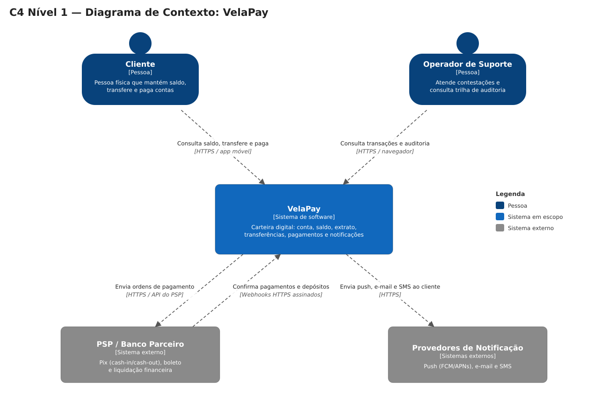
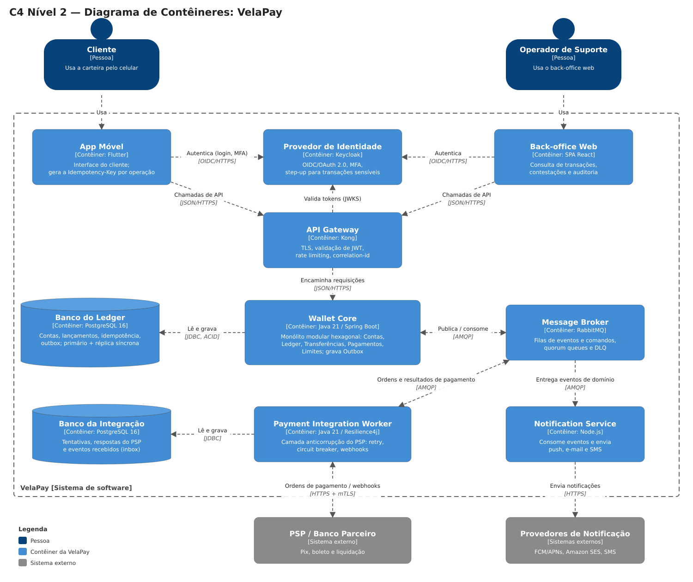

**Disciplina:** Padrões Arquiteturais de Software — Engenharia de Software, 2026/2\
**Professor:** Elias Ferreira\
**Tema:** 5 — Plataforma de Carteira Digital e Pagamentos\
**Grupo:** Marina Pereira Alves e Cristina Gomes\
**Data de entrega:** 16/11/2026

## Sumário

1. Introdução ao sistema proposto
2. Requisitos Arquiteturalmente Significativos (RAS)
3. Estilos arquiteturais adotados
4. Visões de arquitetura — C4 Model (níveis 1 e 2)
5. Decisões arquiteturais significativas
6. Tecnologias associadas às decisões
7. Premissas e riscos em aberto

---

## 1. Introdução ao sistema proposto

### 1.1 Nome e propósito

**VelaPay** é uma carteira digital para pessoas físicas. O cliente mantém uma conta com saldo em reais,
consulta o extrato, transfere dinheiro para outros clientes, paga contas e recebe notificações de cada
movimentação. A VelaPay não é um banco: a entrada e a saída de dinheiro do sistema financeiro nacional
(Pix e boleto) e a liquidação passam por um **PSP / banco parceiro**, integrado por API.

O problema central de arquitetura é **mover dinheiro sem perder, duplicar ou criar saldo**, mesmo com
rede móvel instável, reenvio de requisições, picos de uso e indisponibilidade do parceiro externo.

### 1.2 Principais funcionalidades

| # | Funcionalidade | Descrição |
|---|---|---|
| F1 | Conta e autenticação | Cadastro da conta, login com MFA e confirmação reforçada (*step-up*) para operações sensíveis. |
| F2 | Saldo e extrato | Saldo disponível, saldo bloqueado (valores em processamento) e extrato paginado por período. |
| F3 | Transferência interna (P2P) | Transferência instantânea entre duas contas VelaPay, por chave (telefone, e-mail ou CPF). |
| F4 | Pagamentos externos (cash-out) | Pagamento de boleto e envio de Pix para fora da VelaPay, executados pelo PSP. |
| F5 | Depósito (cash-in) | Crédito na carteira a partir de um Pix recebido, confirmado por *webhook* do PSP. |
| F6 | Notificações | Push, e-mail ou SMS a cada movimentação e mudança de status de pagamento. |
| F7 | Rastreabilidade e suporte | Back-office para o operador consultar a trilha completa de uma transação e tratar contestações. |

### 1.3 Público-alvo e contexto de uso

- **Cliente:** pessoa física que usa a carteira pelo celular, muitas vezes em rede móvel instável, para
  pagar contas, dividir despesas e receber dinheiro. Base estimada (premissa): 500 mil contas
  cadastradas e 50 mil usuários ativos simultâneos no pico.
- **Operador de suporte / back-office:** funcionário da VelaPay que atende contestações, consulta
  transações e a trilha de auditoria.
- **Contexto de uso:** uso contínuo (24×7), com picos previsíveis no início do mês (salários e contas
  com vencimento entre os dias 5 e 10) e em datas comerciais.

### 1.4 Delimitação do escopo

**No escopo:** F1 a F7 acima, com uma única moeda (BRL), um PSP parceiro inicial e limites
transacionais por cliente.

**Fora do escopo (deliberadamente):**

- Cartões (físico ou virtual), crédito, investimentos, câmbio e cashback.
- Onboarding regulatório completo (KYC/AML, análise de documentos): premissa de que a validação de
  identidade é feita por um serviço externo antes da abertura da conta, sem ser modelada aqui.
- Motor antifraude com aprendizado de máquina: o escopo cobre regras simples de limite e *step-up*.
- Relatórios regulatórios, contabilidade corporativa e conciliação bancária avançada.
- Contas de pessoa jurídica e múltiplos titulares.

---

## 2. Requisitos Arquiteturalmente Significativos (RAS)

### 2.1 Lista de RAS

| ID | Tipo | Requisito |
|---|---|---|
| RAS-01 | Atributo de qualidade: **integridade / consistência** | Toda movimentação é registrada em partidas dobradas (débito e crédito de mesmo valor). O saldo disponível nunca fica negativo e a soma de todos os lançamentos do sistema é sempre zero. Uma transação confirmada ao cliente nunca é perdida. |
| RAS-02 | Atributo de qualidade: **confiabilidade (idempotência)** | Uma mesma operação financeira, reenviada pelo app, pelo broker ou pelo PSP, é executada no máximo uma vez. |
| RAS-03 | Atributo de qualidade: **disponibilidade / resiliência** | A indisponibilidade do PSP não pode derrubar saldo, extrato e transferência interna, nem perder pagamentos já aceitos. |
| RAS-04 | Atributo de qualidade: **segurança** | Autenticação forte, autorização por perfil, *step-up* para operações de risco, dados pessoais e financeiros cifrados em trânsito e em repouso. |
| RAS-05 | Atributo de qualidade: **auditabilidade / rastreabilidade** | Cada transação pode ser reconstruída de ponta a ponta (quem pediu, de onde, lançamentos, respostas do PSP, notificações), e o histórico financeiro é imutável. |
| RAS-06 | Atributo de qualidade: **desempenho** | Transferência interna com resposta em tempo de interação (p95 ≤ 500 ms) sob o pico estimado. |
| RAS-07 | Atributo de qualidade: **modificabilidade** | Trocar ou acrescentar provedor de pagamento sem alterar as regras do ledger e das transferências. |
| RAS-08 | Restrição: **regulatória e de privacidade** | Tratamento de dados pessoais conforme a LGPD (Lei nº 13.709/2018) e retenção do histórico de transações por 5 anos (premissa do grupo, a confirmar com a área jurídica). |
| RAS-09 | Restrição: **equipe e prazo** | Equipe pequena (até 4 pessoas), com experiência em Java, e um MVP a ser entregue em um semestre. A arquitetura precisa ser operável por essa equipe. |
| RAS-10 | Requisito funcional de impacto | Pagamento externo é uma operação **longa e em duas partes** (VelaPay e PSP), confirmada de forma assíncrona por *webhook*. Isso exige estado intermediário (valor bloqueado) e compensação em caso de falha. |

### 2.2 Por que esses requisitos são arquiteturalmente significativos

- **RAS-01 e RAS-02** determinam o modelo de dados (ledger *append-only* em vez de saldo como campo
  editável), a escolha de um banco com transações ACID, a estratégia de concorrência e a forma de
  integrar com componentes assíncronos. Um erro aqui é perda financeira direta, e não dá para corrigir
  depois sem migração do histórico.
- **RAS-03 e RAS-10** forçam a separação entre o que é síncrono (operações internas) e o que é
  assíncrono (PSP), e introduzem mensageria, filas de reprocessamento e o padrão Saga.
- **RAS-04** define os contêineres de borda (API Gateway e provedor de identidade) e o fluxo de tokens
  entre eles. É transversal: afeta todos os contêineres.
- **RAS-05 e RAS-08** influenciam o armazenamento (imutabilidade, retenção, cifragem) e exigem
  correlação de logs entre contêineres.
- **RAS-06** limita quantos saltos de rede cabem no caminho da transferência interna e pesa a favor de
  manter o ledger e as transferências no mesmo processo e no mesmo banco.
- **RAS-07** define a fronteira de integração (camada anticorrupção e portas/adaptadores).
- **RAS-09** é a restrição que mais limita a complexidade operacional: pesa contra uma malha de
  microsserviços com bancos distribuídos.

### 2.3 Cenários de atributos de qualidade

**Cenário 1 — Confiabilidade / idempotência (RAS-02, RAS-01)**

| Elemento | Descrição |
|---|---|
| Fonte do estímulo | App móvel do cliente. |
| Estímulo | Após um *timeout* de rede, o app reenvia 3 vezes a mesma transferência de R$ 150,00, com o mesmo cabeçalho `Idempotency-Key`. |
| Ambiente | Operação normal, rede móvel instável; os reenvios chegam a instâncias diferentes do Wallet Core, inclusive de forma concorrente. |
| Artefato | Módulos Transferências e Ledger (Wallet Core) e Banco do Ledger. |
| Resposta | A transferência é executada uma única vez. Cada reenvio recebe a mesma resposta da primeira execução (mesmo `transferId` e status), sem novo lançamento. |
| Medida da resposta | 0 lançamentos duplicados em teste de carga com 10.000 operações reenviadas de forma concorrente; resposta ao reenvio em p95 ≤ 300 ms; chave válida por 24 h. |

**Cenário 2 — Disponibilidade / resiliência (RAS-03, RAS-10)**

| Elemento | Descrição |
|---|---|
| Fonte do estímulo | PSP / banco parceiro. |
| Estímulo | O PSP fica indisponível (respostas 5xx e *timeouts*) por 15 minutos. |
| Ambiente | Horário de pico (dia 5 do mês, 18 h). |
| Artefato | Payment Integration Worker, Message Broker e módulo Pagamentos. |
| Resposta | O *circuit breaker* abre e o worker para de chamar o PSP. Novos pagamentos externos são aceitos com status `PENDENTE` e o valor fica bloqueado no saldo do cliente. Saldo, extrato e transferência interna continuam funcionando. Quando o PSP volta, a fila é processada. Pagamentos não concluídos em 2 h são cancelados e o valor é devolvido (compensação). |
| Medida da resposta | 0 pagamentos aceitos perdidos; disponibilidade da transferência interna ≥ 99,9% durante a falha; fila drenada em ≤ 10 min após o retorno do PSP; cliente notificado do status final em ≤ 1 min após a conclusão. |

**Cenário 3 — Desempenho (RAS-06)**

| Elemento | Descrição |
|---|---|
| Fonte do estímulo | 50.000 clientes ativos simultâneos. |
| Estímulo | 300 transferências internas por segundo e 1.000 consultas de extrato por segundo, sustentadas por 30 minutos. |
| Ambiente | Pico de início de mês, sistema em operação normal, 3 instâncias do Wallet Core. |
| Artefato | API Gateway, Wallet Core e Banco do Ledger. |
| Resposta | As transferências são processadas com consistência (RAS-01) e as consultas de extrato são atendidas pela réplica de leitura. |
| Medida da resposta | Transferência: p95 ≤ 500 ms e p99 ≤ 1 s; extrato de 30 dias: p95 ≤ 300 ms; taxa de erro < 0,1%; CPU do banco primário < 70%. |

**Cenário 4 — Segurança (RAS-04)**

| Elemento | Descrição |
|---|---|
| Fonte do estímulo | Atacante que obteve um *access token* válido de um cliente. |
| Estímulo | Tenta transferir R$ 2.000,00 para uma chave nunca usada pelo cliente. |
| Ambiente | Operação normal. |
| Artefato | API Gateway, Provedor de Identidade e módulo Limites (Wallet Core). |
| Resposta | A operação é recusada até que seja confirmada com um segundo fator (biometria do dispositivo ou código OTP), exigido para valores acima de R$ 500,00 ou para destinatário novo. A tentativa é registrada na trilha de auditoria e um alerta é enviado ao cliente. |
| Medida da resposta | 100% das transações acima do limite ou para destinatário novo sem *step-up* são recusadas; *access token* com validade máxima de 5 min; bloqueio da conta após 5 falhas de MFA em 15 min; alerta ao cliente em ≤ 1 min. |

**Cenário 5 — Auditabilidade (RAS-05, RAS-01)**

| Elemento | Descrição |
|---|---|
| Fonte do estímulo | Operador de suporte. |
| Estímulo | Cliente contesta um pagamento feito há 8 meses; o operador pede a trilha completa da transação. |
| Ambiente | Operação normal. |
| Artefato | Banco do Ledger, Banco da Integração e logs correlacionados. |
| Resposta | O back-office mostra, a partir do `correlationId`, a requisição original (usuário, dispositivo, IP), os lançamentos contábeis, as chamadas e respostas do PSP e as notificações enviadas. |
| Medida da resposta | Trilha disponível em ≤ 5 min; verificação diária recalcula o saldo de 100% das contas a partir dos lançamentos, com 0 divergências aceitas (divergência gera alerta crítico). |

**Cenário 6 — Modificabilidade (RAS-07)**

| Elemento | Descrição |
|---|---|
| Fonte do estímulo | Equipe de desenvolvimento. |
| Estímulo | Integrar um segundo PSP para redundância. |
| Ambiente | Tempo de desenvolvimento. |
| Artefato | Payment Integration Worker. |
| Resposta | Um novo adaptador implementa a porta `PaymentProvider`; a escolha do provedor fica em configuração. |
| Medida da resposta | 0 linhas alteradas nos módulos Ledger e Transferências; entrega em até 2 sprints (4 semanas) por 2 desenvolvedores; testes de contrato do adaptador passando. |

---

## 3. Estilos arquiteturais adotados

### 3.1 Padrão principal: monólito modular com arquitetura hexagonal (Wallet Core)

O núcleo financeiro (**Wallet Core**) é um **monólito modular**: um único artefato implantável,
dividido em módulos de negócio com fronteiras explícitas — **Contas**, **Ledger**, **Transferências**,
**Pagamentos** e **Limites**. Cada módulo segue a **arquitetura hexagonal (portas e adaptadores)**: o
domínio não depende de framework, banco ou broker; a infraestrutura entra por adaptadores que
implementam portas definidas pelo domínio.

**Justificativa com base nos RAS:**

- **RAS-01 e RAS-06:** uma transferência interna debita uma conta e credita outra. Com os módulos no
  mesmo processo e no mesmo banco, isso é **uma única transação ACID local**: sem transação distribuída,
  sem compensação e sem saltos de rede extras no caminho crítico. Em microsserviços, Contas e Ledger em
  serviços separados exigiriam uma Saga até para a operação mais comum.
- **RAS-09:** um artefato, um pipeline e um banco principal são operáveis por uma equipe de 4 pessoas.
- **RAS-07:** as portas e adaptadores isolam o domínio da tecnologia e dos provedores externos.
- **Evolução:** a modularização com fronteiras verificadas permite extrair um módulo para um serviço
  separado no futuro, se a escala pedir, sem reescrever o domínio.

### 3.2 Padrões complementares

| Padrão | Onde | Por que (RAS) |
|---|---|---|
| **Arquitetura orientada a eventos** com **Transactional Outbox** | Entre Wallet Core, Payment Integration Worker e Notification Service, via Message Broker | RAS-03 e RAS-10: a falha do PSP ou do provedor de notificação não bloqueia o núcleo. O Outbox garante que o evento só é publicado se a transação de banco for confirmada (RAS-01). |
| **Saga orquestrada** | Pagamento externo (módulo Pagamentos é o orquestrador) | RAS-10: a operação envolve VelaPay e PSP, sem transação comum. A Saga controla os estados `PENDENTE → CONFIRMADO / CANCELADO` e a compensação (devolução do valor bloqueado). |
| **Ledger de partidas dobradas (*append-only*)** | Módulo Ledger | RAS-01 e RAS-05: o histórico é imutável; correções são novos lançamentos de estorno; o saldo pode ser recalculado a qualquer momento. |
| **Camada anticorrupção (ACL)** | Payment Integration Worker | RAS-07: traduz o modelo e os erros do PSP para o modelo da VelaPay; trocar de PSP fica restrito a esse contêiner. |
| **API Gateway** | Borda do sistema | RAS-04 e RAS-06: um ponto único para TLS, validação de token, *rate limiting* e geração do `correlationId`. |

### 3.3 Como os padrões organizam os elementos e as interações

- **Síncrono só onde é necessário.** O caminho App → API Gateway → Wallet Core → Banco do Ledger é
  síncrono e cobre tudo o que é interno: saldo, extrato e transferência P2P. O cliente tem a resposta
  final na mesma requisição.
- **Assíncrono para tudo o que é externo.** Pagamentos externos e notificações saem do Wallet Core como
  eventos gravados na tabela de **outbox** na mesma transação do lançamento. Um *relay* publica esses
  eventos no **Message Broker**. O **Payment Integration Worker** e o **Notification Service** consomem
  de forma independente, com reprocessamento e fila de mensagens mortas (DLQ).
- **Entrega "pelo menos uma vez" + consumidor idempotente.** Como o broker pode reentregar mensagens,
  todo consumidor registra o `eventId` processado (tabela *inbox*) e ignora repetições. Junto com o
  Outbox, isso dá efeito de "exatamente uma vez" no resultado.
- **Dependências apontam para o domínio.** Dentro do Wallet Core, os módulos só conversam por
  interfaces públicas (API do módulo ou eventos internos), nunca acessando tabelas de outro módulo.
  Essas regras são verificadas por testes de arquitetura no build.

Fluxo de um **pagamento externo** (Saga):

1. O cliente pede o pagamento. O Wallet Core valida limite e *step-up*, cria a ordem `PENDENTE`, move o
   valor da conta do cliente para a conta interna **"valores em trânsito"** (bloqueio) e grava o evento
   `PagamentoSolicitado` no outbox — tudo em uma transação.
2. O relay publica o evento; o Payment Integration Worker o consome e chama o PSP, usando o `paymentId`
   como chave de idempotência do PSP.
3. O PSP responde de forma síncrona ou, mais tarde, por *webhook*. O worker publica `PagamentoConfirmado`
   ou `PagamentoRecusado`.
4. O Wallet Core consome o resultado: na confirmação, liquida o valor em trânsito; na recusa ou
   expiração (2 h), executa a **compensação** (estorno para a conta do cliente).
5. O Notification Service consome os eventos e avisa o cliente.

---

## 4. Visões de arquitetura — C4 Model

### 4.1 Nível 1 — Diagrama de Contexto

| Elemento | Tipo | Papel |
|---|---|---|
| Cliente | Pessoa | Usa a carteira pelo app móvel. |
| Operador de Suporte | Pessoa | Consulta transações e auditoria pelo back-office. |
| VelaPay | Sistema em escopo | Carteira digital. |
| PSP / Banco Parceiro | Sistema externo | Executa Pix e boleto, liquida valores e confirma por *webhook*. |
| Provedores de Notificação | Sistemas externos | Entregam push, e-mail e SMS ao cliente. |

### 4.2 Nível 2 — Diagrama de Contêineres

| Contêiner | Tecnologia | Responsabilidade | RAS |
|---|---|---|---|
| App Móvel | Flutter | Interface do cliente; gera a `Idempotency-Key` de cada operação e a reenvia em caso de falha. | RAS-02, RAS-04 |
| Back-office Web | SPA React | Consulta de transações, contestações e trilha de auditoria. | RAS-05 |
| Provedor de Identidade | Keycloak | Login OIDC, MFA, *step-up*, emissão de tokens de curta duração. | RAS-04 |
| API Gateway | Kong | TLS, validação de JWT, *rate limiting*, `correlationId`, roteamento. | RAS-04, RAS-05, RAS-06 |
| Wallet Core | Java 21 / Spring Boot | Monólito modular hexagonal: Contas, Ledger, Transferências, Pagamentos (orquestrador da Saga) e Limites; grava o outbox e executa o relay. | RAS-01, 02, 06, 10 |
| Banco do Ledger | PostgreSQL 16 | Contas, lançamentos, chaves de idempotência, outbox; primário com réplica síncrona e réplica de leitura para extrato. | RAS-01, 05, 06, 08 |
| Message Broker | RabbitMQ | Eventos de domínio e comandos de pagamento; filas duráveis (*quorum queues*) e DLQ. | RAS-03, RAS-10 |
| Payment Integration Worker | Java 21 / Resilience4j | Camada anticorrupção do PSP: chamadas com *retry* e *circuit breaker*; recebe e valida *webhooks*. | RAS-03, RAS-07 |
| Banco da Integração | PostgreSQL 16 | Tentativas e respostas do PSP e *inbox* de eventos recebidos. | RAS-02, RAS-05 |
| Notification Service | Node.js | Consome eventos e envia notificações com *retry* próprio. | RAS-03 |

**Consistência entre os níveis:** as duas pessoas e os dois sistemas externos do nível 1 aparecem no
nível 2 com os mesmos nomes. A relação "VelaPay ↔ PSP" do contexto é realizada pelo Payment Integration
Worker, e a relação "VelaPay → Provedores de Notificação" pelo Notification Service. A observabilidade
(logs, métricas e *traces*) é transversal e não aparece como contêiner de negócio (ver seção 6).

---

## 5. Decisões arquiteturais significativas

### DA-01 — Monólito modular hexagonal para o núcleo financeiro

| Item | Conteúdo |
|---|---|
| Driver | RAS-01 (consistência), RAS-06 (desempenho), RAS-09 (equipe pequena), RAS-07 (modificabilidade). |
| Alternativas | (a) Microsserviços por subdomínio (Contas, Ledger, Transferências, Pagamentos), cada um com banco próprio; (b) monólito em camadas tradicional; (c) monólito modular com portas e adaptadores. |
| Decisão | **(c)** Monólito modular hexagonal, com fronteiras de módulo verificadas por teste. |
| Justificativa | A transferência interna, operação mais frequente, fica em uma transação ACID local. (a) obrigaria uma Saga em cada transferência e multiplicaria a operação (vários bancos, pipelines e deploys) para uma equipe de 4 pessoas. (b) resolve a consistência, mas tende a acoplar domínio e infraestrutura e a apagar as fronteiras de negócio com o tempo. |
| Consequências positivas | Consistência forte simples de garantir; menos latência; um único deploy; módulos extraíveis no futuro. |
| Consequências negativas | Escala vertical e horizontal do núcleo é feita em bloco; um defeito grave pode afetar todos os módulos; exige disciplina (e testes de arquitetura) para as fronteiras não erodirem. |

### DA-02 — Ledger de partidas dobradas *append-only* em banco relacional ACID

| Item | Conteúdo |
|---|---|
| Driver | RAS-01 (saldo nunca negativo, nada perdido), RAS-05 (auditabilidade), RAS-08 (retenção). |
| Alternativas | (a) Saldo como coluna atualizável, sem histórico estruturado; (b) *event sourcing* completo com banco de eventos dedicado; (c) ledger de partidas dobradas em PostgreSQL, com saldo materializado atualizado na mesma transação. |
| Decisão | **(c)** Lançamentos imutáveis (débito e crédito do mesmo valor) e tabela de saldo materializado, atualizados na mesma transação; concorrência controlada por *lock* de linha (`SELECT … FOR UPDATE`) nas contas envolvidas, sempre na mesma ordem (por ID) para evitar *deadlock*; restrição `CHECK (saldo_disponivel >= 0)`. |
| Justificativa | (a) não permite reconstruir nem auditar o saldo. (b) oferece auditoria completa, mas traz projeções eventualmente consistentes e uma curva de aprendizado alta para a equipe. (c) dá imutabilidade e auditoria com garantias ACID e ferramentas conhecidas. |
| Consequências positivas | Saldo sempre explicável a partir dos lançamentos; verificação diária automática (soma zero e recálculo); estornos rastreáveis; o banco impede saldo negativo mesmo com bug na aplicação. |
| Consequências negativas | Contas muito movimentadas (ex.: conta "valores em trânsito") viram ponto de contenção de *lock*; a tabela de lançamentos cresce sem parar e exige particionamento por data e arquivamento. |

### DA-03 — Idempotência fim a fim com chave do cliente e restrição única

| Item | Conteúdo |
|---|---|
| Driver | RAS-02 (sem execução duplicada), cenário 1. |
| Alternativas | (a) Detectar duplicatas por heurística (mesmo valor, destino e janela de tempo); (b) chave de idempotência guardada em cache (Redis) com TTL; (c) chave de idempotência gerada pelo app e gravada no PostgreSQL, na mesma transação da operação, com restrição `UNIQUE (cliente_id, idempotency_key)`. |
| Decisão | **(c)**, estendida a toda a cadeia: o `paymentId` é a chave de idempotência enviada ao PSP, e cada consumidor de eventos guarda o `eventId` processado (*inbox*). |
| Justificativa | (a) bloqueia operações legítimas (duas transferências iguais de propósito) e deixa passar outras. (b) perde a garantia se o cache cair ou expulsar a chave antes da hora, e não participa da transação do banco. Em (c), a chave e o lançamento são gravados juntos: ou ambos existem, ou nenhum. |
| Consequências positivas | Reenvio seguro em qualquer ponto (app, broker, PSP); a resposta original é devolvida ao reenvio; garantia verificável por teste de concorrência. |
| Consequências negativas | O app e todos os integradores precisam gerar e reenviar a chave corretamente; tabela de chaves exige limpeza periódica (24 h); o PSP precisa aceitar chave de idempotência (critério de seleção do parceiro). |

### DA-04 — Comunicação assíncrona com Transactional Outbox e message broker

| Item | Conteúdo |
|---|---|
| Driver | RAS-03 (PSP indisponível), RAS-10 (operação longa), RAS-01 (nenhum evento perdido), cenário 2. |
| Alternativas | (a) Chamada REST síncrona do Wallet Core ao PSP e ao provedor de notificação; (b) gravar no banco e publicar no broker em seguida, em duas operações (*dual write*); (c) Transactional Outbox: o evento é gravado no banco na mesma transação do lançamento e publicado depois por um *relay*. |
| Decisão | **(c)** Outbox no Banco do Ledger + RabbitMQ, com consumidores idempotentes, *retry* com *backoff* exponencial e DLQ. |
| Justificativa | (a) acopla a disponibilidade e a latência da VelaPay às do PSP: se o PSP cai, o pagamento falha ou fica em estado desconhecido. (b) perde o evento se o processo cair entre as duas operações (dinheiro bloqueado sem pagamento) ou publica um evento de transação desfeita. (c) garante atomicidade entre o estado e o evento. |
| Consequências positivas | Desacoplamento temporal do PSP e das notificações; nenhum pagamento aceito é perdido; picos absorvidos pela fila; novos consumidores (ex.: antifraude) podem ser adicionados sem mudar o núcleo. |
| Consequências negativas | Consistência eventual para o status do pagamento externo (o cliente vê `PENDENTE`); mais um componente para operar (broker); depuração distribuída exige `correlationId` e *tracing*; a tabela de outbox precisa de limpeza. |

### DA-05 — Saga orquestrada com bloqueio de valor e compensação para pagamentos externos

| Item | Conteúdo |
|---|---|
| Driver | RAS-10, RAS-01, RAS-03. |
| Alternativas | (a) Debitar só depois da confirmação do PSP; (b) debitar imediatamente e "torcer" pela confirmação; (c) Saga coreografada (cada participante reage a eventos dos outros); (d) Saga orquestrada pelo módulo Pagamentos, com bloqueio do valor na conta "valores em trânsito" e compensação. |
| Decisão | **(d)** O módulo Pagamentos mantém a máquina de estados (`PENDENTE`, `ENVIADO`, `CONFIRMADO`, `CANCELADO`, `ESTORNADO`) e decide a compensação; expiração em 2 h. |
| Justificativa | (a) permite gastar o mesmo saldo duas vezes enquanto o PSP não responde. (b) deixa o cliente sem dinheiro e sem pagamento se o PSP falhar. (c) espalha a lógica do fluxo entre contêineres, o que dificulta auditar o estado de um pagamento (RAS-05). (d) concentra o estado em um ponto auditável. |
| Consequências positivas | Saldo nunca gasto em dobro; estado de cada pagamento visível e auditável; compensação automática. |
| Consequências negativas | Mais estados e transições para testar; casos ambíguos (PSP confirmou depois do cancelamento por expiração) exigem conciliação e regra de reversão; o cliente vê parte do saldo como "bloqueado". |

### DA-06 — Segurança na borda: API Gateway + provedor de identidade OIDC com *step-up*

| Item | Conteúdo |
|---|---|
| Driver | RAS-04, RAS-08, cenário 4. |
| Alternativas | (a) Autenticação própria implementada no Wallet Core (sessão e senha); (b) provedor de identidade como serviço gerenciado (SaaS); (c) provedor de identidade OIDC próprio (Keycloak) + API Gateway validando tokens, com *step-up* para operações de risco. |
| Decisão | **(c)** Tokens de acesso de 5 min com *refresh token* rotativo; MFA no login; *step-up* (biometria ou OTP) exigido pelo módulo Limites acima de R$ 500 ou para destinatário novo; mTLS e assinatura HMAC nos *webhooks* do PSP; dados sensíveis cifrados com chaves em KMS. |
| Justificativa | (a) mistura segurança com regra de negócio e reimplementa protocolos complexos. (b) reduz operação, mas tira dos dados de identidade o controle de residência e aumenta o custo por usuário; é alternativa válida se a operação do Keycloak se mostrar cara. (c) usa padrões abertos, centraliza a política de autenticação e mantém o Wallet Core focado em autorização de negócio. |
| Consequências positivas | Um ponto único para política de autenticação e *rate limiting*; tokens curtos limitam o dano de vazamento; trilha de autenticação auditável. |
| Consequências negativas | Keycloak e gateway viram dependências críticas (precisam de alta disponibilidade); mais atrito para o cliente nas operações de risco; a equipe precisa operar e atualizar o Keycloak. |

### 5.1 Relação entre RAS e decisões (visão resumida)

| RAS | DA-01 | DA-02 | DA-03 | DA-04 | DA-05 | DA-06 |
|---|:-:|:-:|:-:|:-:|:-:|:-:|
| RAS-01 Integridade | ● | ● | ● | ● | ● | |
| RAS-02 Idempotência | | | ● | ● | | |
| RAS-03 Disponibilidade | | | | ● | ● | |
| RAS-04 Segurança | | | | | | ● |
| RAS-05 Auditabilidade | | ● | | | ● | ● |
| RAS-06 Desempenho | ● | ● | | | | |
| RAS-07 Modificabilidade | ● | | | ● | | |
| RAS-08 LGPD / retenção | | ● | | | | ● |
| RAS-09 Equipe e prazo | ● | ● | | | | |
| RAS-10 Operação longa | | | | ● | ● | |

---

## 6. Tecnologias associadas às decisões

| Tecnologia | Decisão(ões) | Justificativa |
|---|---|---|
| **Java 21 + Spring Boot 3** | DA-01 | Ecossistema maduro para sistemas transacionais e conhecido pela equipe (RAS-09); suporte nativo a transações declarativas. |
| **Spring Modulith** e **ArchUnit** | DA-01 | Verificam no build que os módulos só se comunicam pelas APIs públicas e que o domínio não depende de infraestrutura; impedem a erosão das fronteiras. |
| **PostgreSQL 16** (primário + réplica síncrona + réplica de leitura) | DA-02, DA-03, DA-04 | ACID, `SELECT … FOR UPDATE`, restrições `CHECK` e `UNIQUE`, particionamento por data para a tabela de lançamentos; a réplica síncrona evita perder transações confirmadas em caso de falha do primário (RAS-01), e a de leitura atende o extrato (RAS-06). |
| **RabbitMQ** (*quorum queues*, DLQ) | DA-04, DA-05 | Filas duráveis e replicadas, confirmação de publicação e de consumo, *dead letter* nativo. Preferido ao Kafka porque o volume previsto é moderado e o uso é de filas de trabalho (comandos e notificações), não de *streaming* com reprocessamento de histórico; é mais simples de operar para a equipe. |
| **Resilience4j** | DA-04, DA-05 | *Circuit breaker*, *retry* com *backoff* exponencial e *timeout* nas chamadas ao PSP (cenário 2). |
| **Keycloak** | DA-06 | OIDC/OAuth 2.0, MFA, políticas de sessão e *step-up* por nível de autenticação (`acr`); *open source*, sem custo por usuário. |
| **Kong Gateway** | DA-06 | Validação de JWT, *rate limiting* por cliente, TLS e *plugins* de correlação. |
| **AWS KMS** e cifragem em repouso do banco | DA-06, DA-02 | Gestão e rotação de chaves para dados pessoais e financeiros (RAS-08). |
| **OpenTelemetry + Prometheus/Grafana + Loki** | DA-04, DA-05 | *Traces* distribuídos com `correlationId` do gateway ao PSP; métricas dos cenários (p95, tamanho de fila, estado do *circuit breaker*); logs centralizados para auditoria (RAS-05). |
| **Kubernetes (Amazon EKS)** com PostgreSQL e RabbitMQ gerenciados (Amazon RDS / Amazon MQ) | DA-01, DA-04 | Múltiplas instâncias e zonas de disponibilidade para o Wallet Core e os workers; serviços gerenciados reduzem a operação de banco e broker (RAS-09). |
| **Firebase Cloud Messaging / APNs, Amazon SES** | DA-04 | Canais de notificação usados pelo Notification Service. |
| **Testcontainers + k6** | DA-02, DA-03 | Testes de integração com PostgreSQL e RabbitMQ reais e testes de carga para verificar as medidas dos cenários 1 e 3. |

---

## 7. Premissas e riscos em aberto

**Premissas**

- O PSP parceiro oferece API com chave de idempotência, *webhooks* assinados e ambiente de testes.
- O volume do cenário 3 (50 mil ativos simultâneos e 300 transferências/s no pico) é estimativa do
  grupo, a ser revista com dados reais.
- Retenção de 5 anos e regras de limite (R$ 500 para *step-up*) são premissas de negócio, não normas
  verificadas; devem ser validadas com as áreas jurídica e de risco.

**Riscos a tratar na 2ª entrega**

| Risco | Decisão relacionada | Tratamento previsto |
|---|---|---|
| Contenção de *lock* na conta "valores em trânsito" e em contas muito movimentadas | DA-02 | Avaliar sub-contas de trânsito particionadas (*sharding* da conta interna). |
| Confirmação do PSP depois do cancelamento por expiração | DA-05 | Regra de reversão e rotina de conciliação diária com o extrato do PSP. |
| Crescimento das tabelas de lançamentos, outbox e idempotência | DA-02, DA-03, DA-04 | Particionamento por data e rotinas de limpeza/arquivamento. |
| Wallet Core como ponto único de falha lógica | DA-01 | Múltiplas instâncias, *health checks* e implantação gradual (*canary*). |
| Indisponibilidade do Keycloak impede novos logins | DA-06 | Cluster com réplicas em zonas distintas; tokens já emitidos continuam válidos até expirar. |
